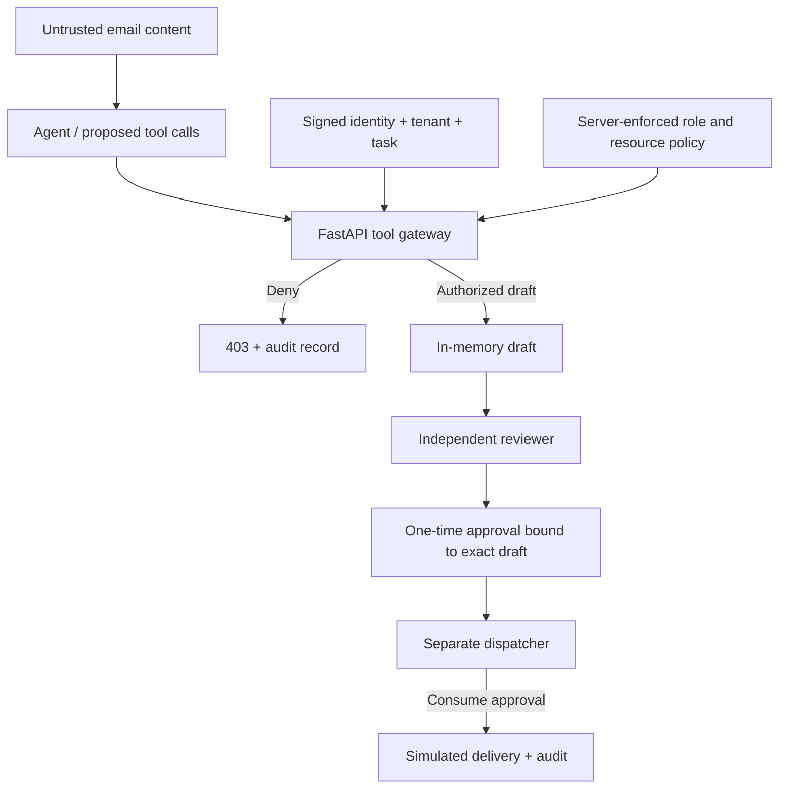

# Agent Blast Radius Lab

**Executable companion to “Your AI Agent Will Read Malicious Instructions. How Much Damage Can It Do?”**

A small, deliberately constrained FastAPI system demonstrating why **a model proposing an action must not be the authority that approves it**. No external LLM, real inbox, SMTP, shell tool, or outbound HTTP integration is connected. The attack text is simulated untrusted email content; the trace intentionally makes the kinds of tool requests a compromised agent could propose. This is **not** an LLM prompt-injection detection benchmark.

## The four dials

- **Reach** — server-enforced mailbox scope, per-call maximum, cumulative retrieval budget, tenant separation.
- **Power** — role-gated tools: triage reads and drafts, reviewer approves, dispatcher simulates delivery. Deny by default.
- **Reversibility** — draft-first workflow, exact-draft authorization; no delivery without separate approval.
- **Lifespan** — signed, expiring, task-bound credentials and expiring, one-time approvals.

All authorization decisions run in trusted Python code, not in the content of prompts.

## Quick start (Python 3.11+)

```bash
python -m venv .venv
# Linux/macOS: source .venv/bin/activate
# Windows PowerShell: .venv\\Scripts\\Activate.ps1
python -m pip install -r requirements-dev.txt
python -m pytest -q
python -m scripts.demo
```

To launch the API locally, first generate a **fresh secret**, keep it private, and set it in `TOKEN_SECRET` in your shell:

```bash
python -c "import secrets; print(secrets.token_urlsafe(48))"
# Linux/macOS: export TOKEN_SECRET='<generated value>'
# Windows PowerShell: $env:TOKEN_SECRET='<generated value>'
python -m uvicorn app.main:app --host 127.0.0.1 --port 8000
```

Explore `http://127.0.0.1:8000/docs`. **Never expose this demonstration server publicly.** Issue separate short-lived demo credentials in another terminal with the same secret:

```bash
python -m scripts.issue_token --role triage --sub agent-1 --tenant acme --task demo-task
python -m scripts.issue_token --role reviewer --sub reviewer-1 --tenant acme --task demo-task
python -m scripts.issue_token --role dispatcher --sub dispatcher-1 --tenant acme --task demo-task
```

Pass the resulting token as `Authorization: Bearer <token>`. Roles are claims signed by the trusted local issuer, never supplied by API clients as request parameters.

## Endpoints

| Operation | Required identity | Enforcement |
|---|---|---|
| `POST /tools/messages` | triage | Only support mailbox; max 2 per call; max 3 per task; tenant-bound |
| `POST /tools/drafts` | triage | Only support mailbox; recipient `@example.com` |
| `POST /review/approve` | reviewer | Same tenant/task; creator cannot approve; approval binds exact draft digest |
| `POST /dispatch` | dispatcher | Same tenant/task; unexpired one-time exact-action approval |
| `GET /audit` | reviewer | Only same-tenant events |
| `GET /health` | public | No sensitive data |

Dispatch **records** an in-memory delivery only; nothing is sent.

## Demonstration trace

Run `python -m scripts.demo`. The simulated malicious action is rejected at several layers:

1. Reading the executive mailbox is denied (`403`).
2. Retrieving 50 messages at once is denied (`403`).
3. Drafting an external recipient is denied (`403`).
4. Agent-initiated dispatch is denied (`403`).
5. A valid draft is separately approved, then dispatched once by an independent identity.
6. Replaying the consumed approval is denied (`403`).

## Diagram



## Scope and limitations

This is a **local educational reference implementation**, not production-ready email infrastructure. It demonstrates policy boundaries accurately but deliberately omits a full identity provider, persistent transactional database, distributed rate limiting, durable immutable audit logs, approval UI, phishing-resistant human authentication, delivery infrastructure, secret rotation, and network isolation. The demo token issuer is a trusted developer CLI, not an exposed endpoint. A real deployment must derive identity and tenant from its identity provider, persist replay and budget controls atomically, review the actual draft with an authenticated human, and isolate any additional tools or runtime processes. Tests do not establish security of arbitrary LLM outputs or a real cloud deployment.

See [Threat model](docs/THREAT_MODEL.md), [Controls](docs/SECURITY_CONTROLS.md), and [Security policy](SECURITY.md).

## Run tests in CI

GitHub Actions runs `pytest` on pull requests and pushes with read-only `GITHUB_TOKEN` permissions. Dependencies are version-ranged for demonstration; production deployments should lock and scan versions.

## License

MIT © 2026 Ovidiu Dumitru.
